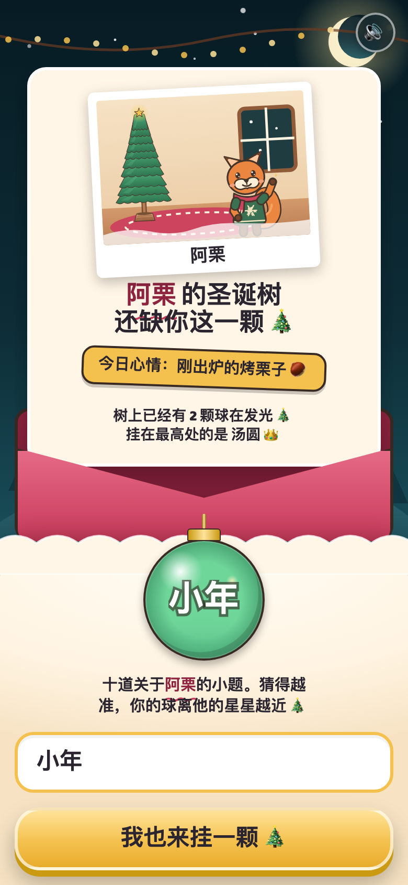
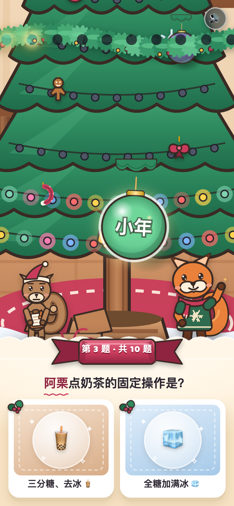
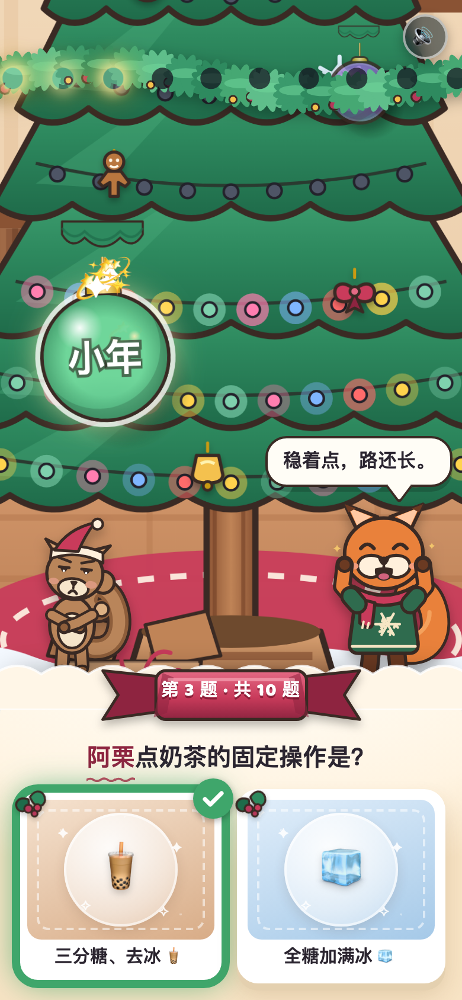
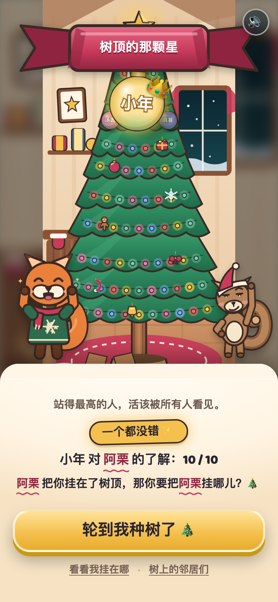

# 🎄 圣诞树上，你能挂到第几层？

**在线试玩：<https://15392912777.github.io/christmas-tree/>**（GitHub Pages） · [源码仓库](https://github.com/15392912777/christmas-tree)

一个可以直接拿去发布的「圣诞树默契问答」小游戏。**场景、角色、题目、台词与代码全部从零创作**：没有一张图片素材，没有任何第三方版权内容。

玩法很简单：回答 10 道关于主人「阿栗」的小问题，答对一题，球就升高一层；最后看看你的球停在树顶、正中间、最下面的树枝，还是没离开礼物盒。

| 邀请函 | 爬树答题 | 答对 | 结局 |
| --- | --- | --- | --- |
|  |  |  |  |

## 怎么打开

- **双击 `index.html`** 即可在浏览器里玩（`file://` 直接运行，不用打包，也不用起本地服务）。
- 也可以放到任意静态托管上，例如 `python3 -m http.server 8000` 后访问 <http://localhost:8000>。
- 手机竖屏最舒服；320–480px 宽都适配，电脑上会显示成居中的 480px 手机框。

## 一轮游戏的流程

1. 先给圣诞球起名字——输入的同时，名字会出现在首页那颗粉色球上。
2. 点「我也来挂一颗 🎄」，看一小段开场：狐狸阿栗出来打招呼，松鼠豆豆抱着礼物盒登场，把你的球放进盒子里。
3. 连续 10 道关于阿栗的题，每题两张「贴纸卡」，选完后马上告诉你对错。
4. 答对：球弹到更高一层，那层的彩灯亮起，顶部花环也亮一颗，阿栗和豆豆各有反应；答错：正确选项亮绿、画面轻震、灯泡闪灭。
5. 全部答完进入结算：按答对数量，你会落在 **树顶 / 正中间 / 底下的树枝 / 礼物盒里**，同时能看到分数、评语、树上邻居榜和分享文案。
6. 中途会超过别的朋友（汤圆、麻薯）的球；最后一题之前房间会暗下来，只剩星星和灯。

## 美术：全部是代码画的

- **没有任何图片文件**。房间、圣诞树、彩灯串、丝带、雪花边、冬青、10 种挂饰、礼物盒、夜空……都由 [`js/art.js`](js/art.js) 在运行时生成 SVG，统一走「纸艺贴纸」风格：粗描边、平涂色块、简单几何。
- **角色**：狐狸主持阿栗、松鼠助手豆豆，一共 18 个姿势，全部在 [`js/mascots.js`](js/mascots.js) 里用 SVG 手写（挥手、欢呼、紧张、惊讶、捂脸、星星眼、到场、大笑、蹲下、戴帽子；抱板子、抱臂、翻白眼、递礼物、扶帽、偷笑、指向圣诞树、摊手）。
- **选项插画**：每个选项用「大 emoji + 配色贴纸卡」表达（字段 `emoji` 与 `tone`），不复制任何他人插画。
- **声音**：全部由浏览器 Web Audio 现场合成（铃铛、上扬音、彩灯音阶、对错提示、一段音乐盒小圆舞曲），项目里没有任何音频文件。
- **文字**：题目、台词、结局、分享文案都收在 [`js/data.js`](js/data.js)，为本项目新写。

## 换成你自己的圣诞树

主要内容都集中在 [`js/data.js`](js/data.js)：

```js
window.XM_QUIZ = {
  creator: '阿栗',                        // 被猜的人
  pronouns: { them: '他', their: '他的' },  // 文案里的代词
  mood: '刚出炉的烤栗子 🌰',               // 首页贴纸
  top: '汤圆',                            // 现在挂在最高处的人
  others: [{ name: '汤圆', score: 10 }, { name: '麻薯', score: 5 }],

  questions: [                             // 10 道题，每题 2~4 个选项
    { id: 'q1', q: '阿栗的早餐更偏哪一口？', options: [
      { text: '甜口党 🥞', correct: true,  emoji: '🥞', tone: 'gold' },
      { text: '咸口党 🍳', correct: false, emoji: '🍳', tone: 'moss' }
    ] },
    // …
  ],

  copy: { /* 界面上的所有句子，支持占位符，文件顶部有说明 */ }
};
```

- `tone` 可选：`berry` `mint` `gold` `sky` `cocoa` `plum` `moss` `peach`（决定卡片配色）。
- 文案占位符：`{creator}` `{them}` `{their}` `{name}` `{n}` `{k}` `{total}` `{mood}` `{top}` `{zoneName}`。
- 部署好之后把 `shareUrl` 填上你的链接，分享文案会自动带上它。
- 想换画风：改 [`js/art.js`](js/art.js) 顶部的 `C` 色板和各个 SVG 形状；想换角色：改 [`js/mascots.js`](js/mascots.js)，保持 `fox(pose)` / `squirrel(pose)` 两个接口即可。
- 还有几处「不好放进题库」的短句：开场面板的加载提示写在 [`css/style.css`](css/style.css)（`.qpanel.is-questionless::before`），声音按钮的读屏文字写在 [`js/sound.js`](js/sound.js)，`index.html` 里保留了首屏的兜底标题与描述。其余界面文字都来自 `data.js`。

## 文件说明

```
christmas-tree-original/
├── index.html          邀请函 / 爬树答题 / 结局 三个场景 + 邻居榜抽屉
├── css/style.css       版式、纸片面板、丝带、圣诞球、雪、彩灯、对错态、动画
├── js/data.js          ★ 题库、人设、全部文案（改成自己的树主要动这里）
├── js/art.js           手写 SVG 场景库：房间、树、挂饰、丝带、花环、雪花边、礼物盒、夜空
├── js/mascots.js       手写 SVG 角色：狐狸阿栗 10 个姿势 + 松鼠豆豆 8 个姿势
├── js/game.js          引擎：场景状态机、320×640 世界坐标、镜头、答题结算、榜单、分享
├── js/sound.js         WebAudio 音效与背景音乐（无素材文件，可静音并记住状态）
├── docs/               文档截图
├── qa/                 发布前的独立测试报告与截图
└── README.md
```

## 实现上的几件事

- **树是一张 320×640 的 SVG 长图**：10 层树冠由 `tierPath(n)` 生成（圆角顶、波浪底边），彩灯、挂饰、圣诞球按 `TIER_Y` 和 `halfWidth(y)` 落到对应枝层。
- **镜头**：用 `translateY` 与 `scale` 在这张长图上取景；答对时球飞向 `notchPoint(n)`，低层会自动推近（最多 1.4 倍），保证球始终在「花环下方、角色头顶上方」的可见范围内。
- **状态机**：邀请 → 开场 → 10 轮（问题 → 揭晓）→ 结算；连对、超过别人、最后一题暗场等节奏节点都有，但台词是重新写的。
- **结算分区**：答对 ≥90% 树顶、≥70% 正中间、≥50% 底下的树枝、其余礼物盒里；全对时球会变成金色并撒星星。
- **零依赖**：字体优先使用 Google Fonts 的 Baloo 2 / Nunito / Shantell Sans（开源字体），离线时回落到系统中文字体；emoji 由系统字体渲染，项目不打包字体。

## 跑在哪些浏览器

iOS Safari 15+、Android Chrome 90+、桌面 Chrome / Safari / Edge 的现代版本。用了 `dvh`、`container-type` 等较新的 CSS；很旧的 WebView 会退回简化版式，但流程仍能走完。

## 版权

- 这个目录里的代码、SVG 美术和文案都是本项目原创，可自由用于个人或商业项目（欢迎保留这份说明）。
- 唯一的外部请求是 Google Fonts 的样式表（开源字体，可离线回落）；项目不包含任何第三方图片、音频或字体文件。
- 想把游戏发给朋友之前，把 `js/data.js` 的主人公、题目和文案换成你的版本，并填好 `shareUrl`。
- 之前的「原站体验复刻版」放在 `../christmas-tree/`，只用于对照学习，**不要对外发布**。
- 发布前的独立检查报告在 [`qa/QA-REPORT.md`](qa/QA-REPORT.md)。
